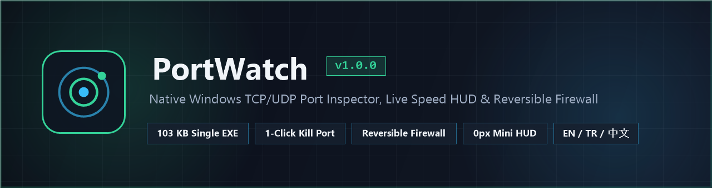
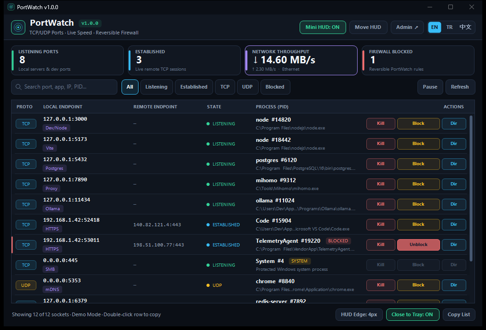

<p align="center">
  
</p>

<p align="center">
  <strong>English</strong> | <a href="README.zh-CN.md">简体中文</a>
</p>

<p align="center">
  <a href="https://github.com/rodvay/PortWatch/releases/latest"></a>
  
  
  
  <a href="LICENSE"></a>
</p>

---

**PortWatch** is an ultra-lightweight (**~104 KB**), single-file native Windows 10/11 utility that lets you inspect **every live TCP/UDP port & connection**, **kill port-hogging processes in 1 click**, monitor **real-time network speed**, and **reversibly block/unblock any app in Windows Firewall** — with zero Electron bloat, zero telemetry, and zero installers.

> Built for developers tired of running `netstat -ano | findstr :3000` + `taskkill /PID ...`, and power users who want an instant visual GlassWire/TCPView alternative in ~100 KB.

## Screenshot

<p align="center">
  
</p>

## Key Features

- **Native Kernel Socket Table (`iphlpapi.dll`):** Instant IPv4 & IPv6 `TCP` / `UDP` table directly via `GetExtendedTcpTable` & `GetExtendedUdpTable` — no `netstat.exe` spawning or flicker.
- **30+ Dev & Proxy Service Tags:** Automatically tags `3000 Dev/Node`, `5173 Vite`, `5432 Postgres`, `6379 Redis`, `7890 Proxy`, `8080 HTTP-Alt`, `10808 SOCKS5`, `11434 Ollama`, `27017 MongoDB`, and more.
- **1-Click Safe Port Killer:** Kill any stuck dev server or rogue app with confirmation (default **No**), PID-reuse verification, and built-in **OS Critical Process Protection** (`System`, `csrss`, `lsass`, `services`, `svchost`, `dwm`, `explorer`, `MsMpEng` are always locked).
- **Reversible 1-Click Windows Firewall Block / Unblock:** Creates clean, path-hashed inbound & outbound rules prefixed with `PortWatch Block - ...` so you can silence telemetry or background updaters in 1 click and restore them anytime without touching your existing rules.
- **32-bit Per-Pixel Alpha Mini Net-Speed HUD:** Optional always-on-top click-through pill (`↓ MB/s | ↑ MB/s | N PORTS`) with **`0px` flush top edge** and **Unlock & Drag Anywhere** support.
- **Instant Search, Filters & Clipboard Export:** Real-time search by port, app name, IP, tag, or PID (`Ctrl+F`); 1-click filter pills (`All`, `Listening`, `Established`, `TCP`, `UDP`, `Blocked`); double-click any row to copy details or click **Copy List** for TSV export.
- **Trilingual Native UI (`EN / TR / 简体中文`):** Auto-detects Windows UI language, switches live with zero restart, Per-Monitor V2 DPI scaling, dark title bar, System Tray & Single-Instance Mutex.

## Download & Run

1. Grab **`PortWatch.exe`** from [GitHub Releases](https://github.com/rodvay/PortWatch/releases/latest).
2. Double-click to run — **100% portable**, no installation required.
3. Click **`Admin ↗`** inside the header only when you want to add/remove Windows Firewall rules or kill elevated processes.

### Build from Source (Zero External SDK Required)

Uses only the built-in Windows .NET Framework 4.x C# compiler (`csc.exe`):

```powershell
.\build.ps1
```

## Türkçe Özet

**PortWatch**, Windows 10/11 için yalnızca **~104 KB** boyutunda, kurulumsuz, tek dosya yerel **TCP/UDP Port, Canlı Ağ Hızı ve Tek Tık Geri Alınabilir Güvenlik Duvarı** aracıdır:
- Geliştirme sunucularını (`3000`, `5173`, `5432`, `8080`, `11434`) ve aktif bağlantıları anında gösterir; takılı kalan portları kritik sistem süreçlerini koruyarak tek tıkla serbest bırakır.
- İstenmeyen uygulamaların internet erişimini Windows Güvenlik Duvarı üzerinden tek tıkla engeller ve dilediğinizde tek tıkla geri açar.
- İsteğe bağlı `0px` kenarlı, tıklama geçirgen ve serbestçe sürüklenebilir **Mini Ağ Hızı HUD** içerir.

## Part of the Zero-Bloat Windows Suite

Check out the full native open-source collection on [**@rodvay**](https://github.com/rodvay):
- [**PCUptime**](https://github.com/rodvay/PCUptime) — Uptime, BSOD & Sleep/Wake diagnostics
- [**SafeSweep**](https://github.com/rodvay/SafeSweep) — Transparent 2-step system junk & cache cleaner
- [**WinForge**](https://github.com/rodvay/WinForge) — Reversible Windows Optimizer, Debloater & Winget Manager
- [**CorePulse**](https://github.com/rodvay/CorePulse) — Hardware telemetry, PWM fan curve controller & 32-bit Gaming HUD
- [**PortWatch**](https://github.com/rodvay/PortWatch) — TCP/UDP port killer, live speed HUD & reversible firewall
- [**LumiBar**](https://github.com/rodvay/LumiBar) — DDC/CI multi-monitor brightness, warm night tint & smart power guard

## License

[MIT License](LICENSE) © 2026 [rodvay](https://github.com/rodvay)
