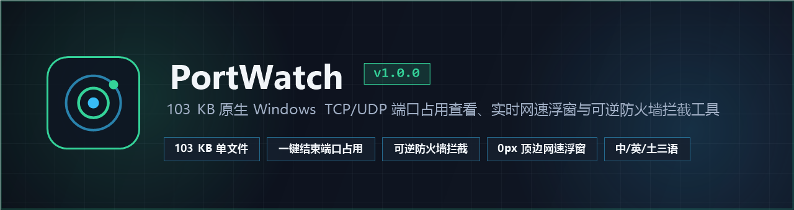
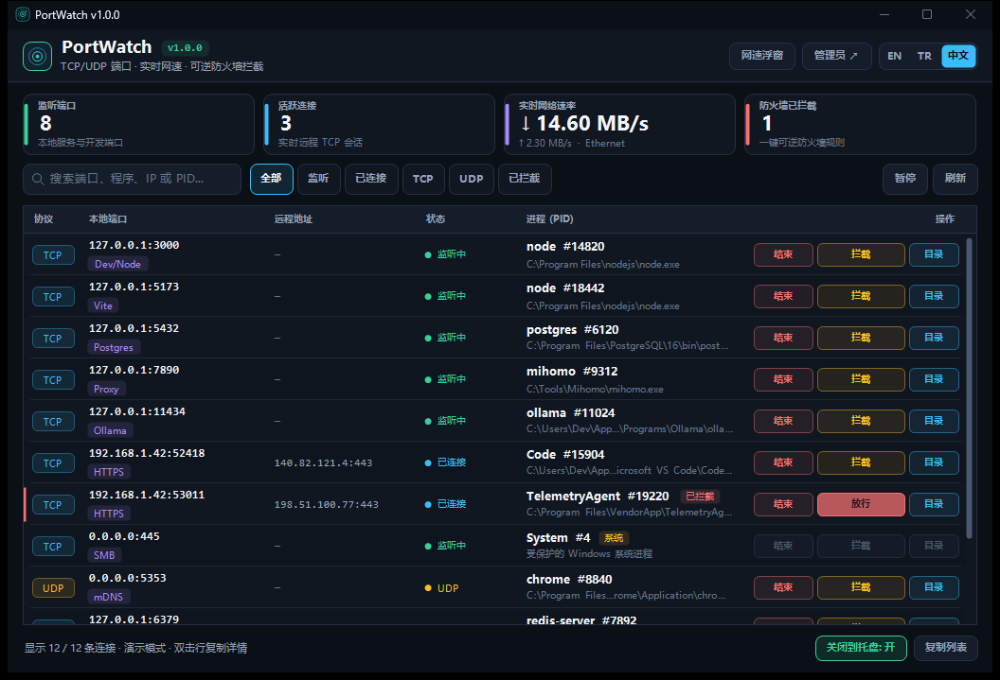

<p align="center">
  
</p>

<p align="center">
  <a href="README.md">English</a> | <strong>简体中文</strong>
</p>

<p align="center">
  <a href="https://github.com/rodvay/PortWatch/releases/latest"></a>
  
  
  
  <a href="LICENSE"></a>
</p>

---

**PortWatch** 是一款仅 **~104 KB** 的原生单文件 Windows 10/11 网络工具：实时查看所有 **TCP/UDP 端口占用与远程连接**、**一键结束占口进程**、显示 **实时上下行网速浮窗**，并支持 **一键可逆 Windows 防火墙拦截/放行** —— 无 Electron 臃肿、无后台遥测、绿色免安装。

> 告别反复输入 `netstat -ano | findstr :3000` 和 `taskkill`，更像是一款 100 KB 级、开箱即用的现代暗色版 TCPView + 迷你防火墙。

## 界面预览

<p align="center">
  
</p>

## 核心特性

- **原生内核套接字表 (`iphlpapi.dll`)：** 直接调用 `GetExtendedTcpTable` / `GetExtendedUdpTable` 读取全量 IPv4 & IPv6 TCP/UDP 连接，毫秒级刷新，绝不弹窗或调用 `netstat`。
- **内置 30+ 开发与代理端口识别：** 自动高亮标注 `3000 Dev/Node`、`5173 Vite`、`5432 Postgres`、`6379 Redis`、`7890 Proxy`、`8080 HTTP-Alt`、`10808 SOCKS5`、`11434 Ollama`、`27017 MongoDB` 等常见端口。
- **一键安全释放端口：** 结束进程前二次确认（默认选 **否**）、校验 PID 复用防误杀，并永久锁定保护核心系统进程（`System`、`csrss`、`lsass`、`svchost`、`dwm`、`explorer`、`MsMpEng`）。
- **一键可逆 Windows 防火墙拦截/放行：** 自动为目标程序创建带路径哈希的独立进出站拦截规则（`PortWatch Block - ...`），随时一键拦截后台偷跑程序，随时一键恢复放行，不破坏系统原有规则。
- **32-bit 透明迷你网速浮窗（Mini HUD）：** 可选常驻置顶小药丸（`↓ 网速 | ↑ 网速 | N 端口`），默认鼠标穿透，支持 **`0px` 紧贴屏幕顶部** 以及 **解锁自由拖动** 到任意位置。
- **极速筛选与复制：** `Ctrl+F` 按端口、程序名、IP、标签或 PID 即时过滤；支持 `全部 / 监听 / 已连接 / TCP / UDP / 已拦截` 快速切换；双击任意行复制详情，点击「复制列表」导出 TSV。
- **原生三语与高清适配：** 支持 **简体中文 / English / Türkçe**（自动识别系统语言），Per-Monitor V2 高分屏适配、原生暗色标题栏、托盘常驻、单实例防多开。

## 下载与使用

1. 前往 [GitHub Releases](https://github.com/rodvay/PortWatch/releases/latest) 下载 **`PortWatch.exe`**。
2. 双击直接运行，无需安装任何运行库。
3. 仅在需要修改 Windows 防火墙规则或结束高权限进程时，点击右上角 **`管理员 ↗`** 提权即可。

### 本地零依赖编译

仅使用 Windows 系统自带的 .NET Framework 4.x 编译器 (`csc.exe`)：

```powershell
.\build.ps1
```

## 原生零臃肿 Windows 工具全家桶

欢迎访问 [**@rodvay**](https://github.com/rodvay) 查看同系列全部开源免费工具：
- [**PCUptime**](https://github.com/rodvay/PCUptime) — 开机时长、蓝屏 BSOD 与睡眠唤醒诊断
- [**SafeSweep**](https://github.com/rodvay/SafeSweep) — 透明两步式系统垃圾与缓存安全清理
- [**WinForge**](https://github.com/rodvay/WinForge) — 可逆式 Windows 隐私优化、精简与 Winget 管理
- [**CorePulse**](https://github.com/rodvay/CorePulse) — 硬件温度监控、PWM 风扇曲线与 32-bit 游戏顶栏 HUD
- [**PortWatch**](https://github.com/rodvay/PortWatch) — TCP/UDP 端口占用查杀、迷你网速浮窗与可逆防火墙
- [**LumiBar**](https://github.com/rodvay/LumiBar) — DDC/CI 多显示器硬件亮度调节、护眼色温与智能防休眠定时

## 开源协议

[MIT License](LICENSE) © 2026 [rodvay](https://github.com/rodvay)
